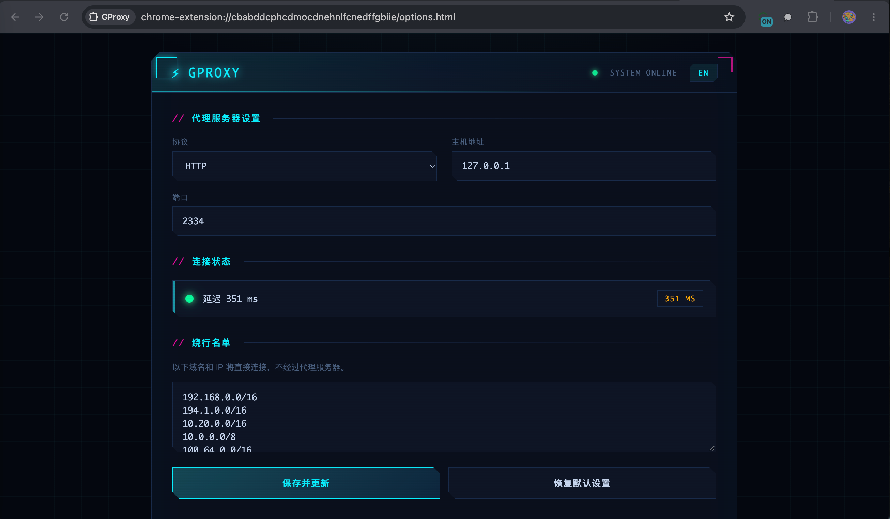

  

  Easy use Web Proxy

  
  

# GProxy

#### 介绍

GProxy 是一款开源的谷歌浏览器（Chrome / Edge 等 Chromium 内核浏览器）代理插件，基于 Manifest V3 开发。它可以按需代理浏览器请求，免去开启全局代理导致系统其他软件无法使用或连接变慢的问题。

默认内置国内常见站点绕行名单，国内网站直连、其余流量走代理，真正做到「无缝切换、按需分流」。

#### 功能特性

- 支持 HTTP / HTTPS / SOCKS4 / SOCKS5 四种代理协议
- 内置绕行名单（Bypass List），国内站点直连、境外流量走代理
- 页面悬浮开关：可拖拽、贴边自动隐藏，点击即可开关代理
- 右键菜单：一键开关代理、将当前域名加入绕行名单、打开设置
- 快捷键 `Ctrl + Shift + Y` 快速开关代理
- 连接状态实时检测与延迟测试
- 中 / 英文双语界面
- 工具栏角标显示当前代理开关状态（ON / OFF）

#### 安装教程

1. 下载并解压本项目
2. 打开浏览器扩展管理页（`chrome://extensions/` 或 `edge://extensions/`）
3. 打开右上角「开发者模式」
4. 点击「加载已解压的扩展程序」，选择解压后的文件夹即可

#### 使用说明

1. 点击工具栏上的 GProxy 图标，或右键菜单选择「打开 GProxy 设置」进入设置页
2. 填写代理服务器地址，默认 `http://127.0.0.1:2334`
3. 点击「保存并更新」应用配置
4. 通过以下任意方式开关代理：
   - 页面右侧悬浮开关按钮
   - 浏览器右键菜单 GProxy → 开启 / 关闭
   - 快捷键 `Ctrl + Shift + Y`
5. 如需某域名直连，可右键菜单选择「将当前域名加入绕过名单」，或在设置页手动编辑绕行名单

#### 插件截图

#### 参与贡献

1. Fork 本仓库
2. 新建 `Feat_xxx` 分支
3. 提交代码
4. 新建 Pull Request

#### 许可证

本项目基于 [Apache License 2.0](https://www.apache.org/licenses/LICENSE-2.0) 开源。
